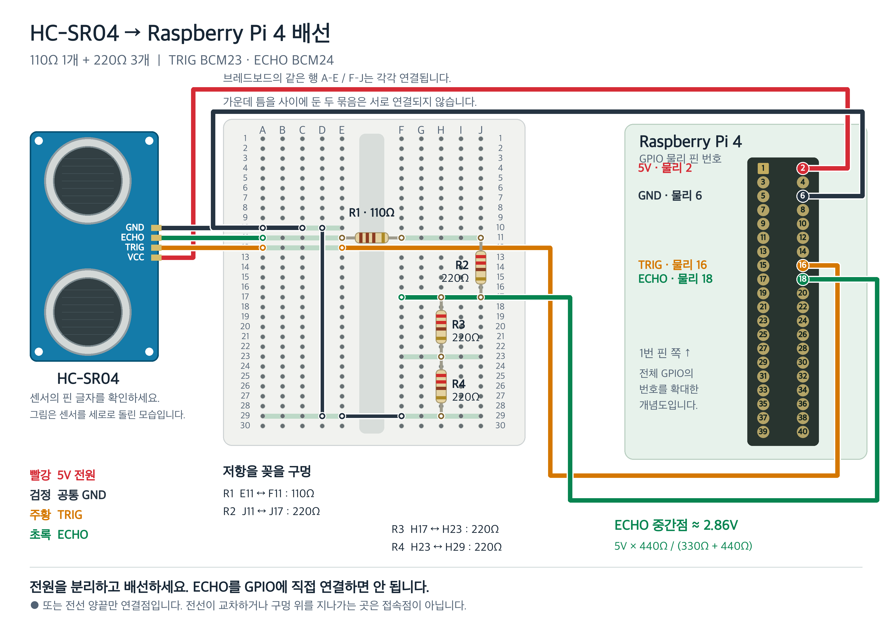

# 근접 감지 및 사진 로컬 저장

이번 구현은 HC-SR04 거리 측정 → Camera Module 3 활성화 → 사진 한 장 저장까지다. 초음파 센서는 사람과 다른 물체를 구분하지 않는다. HC-SR501, 사람 인식, 서버, MQTT, HTTP, Event ID는 구현 범위가 아니다. 실제 Pi의 OS·Python 버전은 사용자 출력으로 확인했으며 센서·카메라·배선 및 동작은 아직 검증하지 않았다. 아래 GPIO와 임계값은 보정 전 개발 예시다.

## 실행 요구사항

| 구분 | 요구사항과 확인 상태 |
|---|---|
| 모의 실행·테스트 | Python 3.9 이상, 표준 라이브러리만 사용 |
| 실제 Pi | OS 제공 Python과 아래 APT 패키지, CSI 카메라와 HC-SR04. 사용자 출력 기준 Python 3.13.5, OS 표기는 Debian GNU/Linux 13(trixie), `DEBIAN_VERSION_FULL=13.7`. 패키지 설치·실제 하드웨어 동작은 미검증 |
| 프로젝트 목표 | SAD의 Python 3.13 목표와 실제 Pi의 3.13.5가 일치. 시스템 Python을 그대로 사용 |

위 실제 환경 정보는 2026-11-16 사용자가 전달한 `python3 --version`, `cat /etc/os-release` 결과다. 이후 같은 Pi의 Python 3.13.5에서 `python3 -m unittest discover -s tests -v` 테스트 14개가 1.108초에 모두 통과한 출력을 확인했다. 개발용 Mac의 Python 3.9.6에서도 같은 14개가 통과했다. 테스트는 모의 센서·카메라와 오류 처리를 검증하며 실제 배선·센서 측정·카메라 촬영 성공을 의미하지 않는다.

`test_failure_does_not_retry_held`에서 출력되는 `ERROR:root: ... result=failed reason=failed`는 의도적으로 촬영 실패를 발생시키는 테스트의 예상 로그다. 해당 테스트의 `ok`와 전체 결과 `OK`로 통과 여부를 확인한다.

`pyproject.toml`의 `requires-python = ">=3.9"`는 패키지를 pip로 설치할 때 검사하는 메타데이터다. `python3 -m`으로 직접 실행할 때 이 조건을 강제하지 않으므로 `python3 --version`으로 직접 확인한다. pip 설치는 필수가 아니다. Pi의 카메라·GPIO 패키지는 `requirements-apt.txt`에서 관리하며 pip requirements에는 넣지 않는다. OS별 패키지 가용성과 native libcamera 연동은 실제 Pi에서 확인한다. 시스템 Python을 교체하지 않는다.

## 노트북에서 모의 검증

이 디렉터리(`smart-doorbell/iot`)에서 Python 3.9 이상으로 실행한다. 외부 패키지는 필요 없다. `MOCK` 로그와 `captures/MOCK_*.png`는 카메라 사진이 아니라 프로그램이 생성한 모의 이미지다.

```bash
cd smart-doorbell/iot
python3 -m unittest discover -s tests -v
python3 -m proximity_camera run --mode mock --max-captures 1
python3 -m proximity_camera sensor --mode mock
python3 -m proximity_camera camera --mode mock
```

기본 모의 입력은 가까워짐, 유지, 오류, 멀어짐, 재접근을 포함하며 입력이 끝나면 종료한다. 실제 시간 조건으로 재무장하려면 멀리 있는 상태가 쿨다운을 만족하도록 설정해야 한다. 설정 변경 시 `cp config.example.json config.local.json`으로 복사한 뒤 수정하고 다음처럼 실행한다. 경로는 실행 디렉터리 기준이다.

```bash
python3 -m proximity_camera run --mode mock --config config.local.json --max-captures 1
```

`--max-captures`는 성공 수가 아니라 촬영 시도 횟수 상한이다. 생략하면 모의 입력 끝 또는 Ctrl+C까지 실행한다. 파일에 설정되지 않은 항목은 기본값을 쓴다. `camera_width`, `camera_height`, `camera_af_timeout_s`, `camera_capture_timeout_s`, 전체 `camera_timeout_s`를 조정할 수 있다. `config.local.json`에 비밀번호를 넣지 않는다.

## 학교 Pi 준비: 2026-11-17

1. Pi 전원을 끈 후 Camera Module 3를 Pi 4 `CAMERA` CSI 커넥터에 맞는 표준 15핀 케이블로 연결한다. 양끝 케이블 방향과 접점은 [공식 연결 그림](https://www.raspberrypi.com/documentation/accessories/camera.html)으로 확인한다.
2. Pi를 켜고 SSH로 접속한다. 예: `ssh ee333@doorbell.local`. 접속이 안 되면 Pi의 실제 IP와 SSH 서비스 상태를 확인한다. 우선 Git을 설치한 뒤 저장소를 클론한다. 아래는 `~/smart-doorbell`이 아직 없는 경우다. 이전에 복사한 `~/iot`가 있다면 어느 폴더에서 실행하는지 구분한다.

```bash
# Pi에서
sudo apt update
sudo apt install git
cd ~
git clone --branch codex/iot-proximity-camera --single-branch https://github.com/yunho04/smart-doorbell.git
cd ~/smart-doorbell/iot
xargs -r -a requirements-apt.txt sudo apt install --
python3 -m venv --system-site-packages .venv
source .venv/bin/activate
cat /etc/os-release
python3 --version
hostname -I
rpicam-hello --list-cameras
rpicam-still -n --autofocus-on-capture -o test.jpg
```

설치는 Raspberry Pi OS 기준 예시다. 패키지 오류가 나면 실제 OS의 패키지 저장소와 지원 여부를 확인한다. 카메라 사진을 열어 초점과 방향을 확인한다. 현재 Pi의 Python은 3.13.5로 확인했으나 카메라·GPIO 패키지 설치와 호환성은 아직 미검증이다.

3. 센서와 저항의 실제 표기·값을 확인하고 전원을 끈 상태에서 배선한다. 아래는 **미검증 개발 예시**이며 BCM 번호와 물리 핀 번호를 구분한다. 일반 HC-SR04의 ECHO는 5V이므로 GPIO에 직접 연결하지 않는다. [GPIO Zero 공식 HC-SR04 배선](https://gpiozero.readthedocs.io/en/stable/api_input.html#distancesensor-hc-sr04)도 확인한다.

현재 보유 부품 중 **1kΩ 2개와 220Ω 1개가 있으면 아래 구성을 우선 사용**한다. ECHO에서 GND까지 저항 세 개를 직렬로 연결하고 첫 번째 1kΩ 뒤의 중간점을 Pi BCM24(물리18)에 연결한다. 중간점에서 GND까지는 1kΩ+220Ω=1.22kΩ이며 명목 5V 입력에서 `5 × 1220 / (1000 + 1220) ≈ 2.75V`다. 1kΩ을 병렬로 연결하는 구성이 아니다.

```text
ECHO ── 1kΩ ──┬── Pi BCM24 (물리 18)
              │
             1kΩ
              │
             220Ω
              │
             GND
```


| 부품·점퍼 | 위 그림에서 꽂을 구멍 |
|---|---|
| R1 1kΩ | E11 ↔ F11 |
| R2 1kΩ | H11 ↔ H17 |
| R3 220Ω | H17 ↔ H23 |
| 센서 GND / Pi GND(물리 6) | 각각 A10 / C10 |
| 공통 GND 점퍼 | D10 ↔ D23, E23 ↔ F23 두 개 |
| 센서 ECHO | A11 |
| 분압 출력 → Pi BCM24(물리 18) | J11에서 Pi로 연결 |
| 센서 TRIG / Pi BCM23(물리 16) | 각각 A12 / E12 |
| 센서 VCC | Pi 5V(물리 2)에 직접 연결 |

센서는 세로로 돌려 표시했으므로 실물의 핀 글자를 기준으로 연결한다. GPIO 그림은 물리 번호 확대도이며 실제 보드의 1번 핀 위치를 먼저 확인한다. 같은 행 A–E와 F–J는 각각 연결되며 가운데 틈 양쪽은 별개다. 전선의 교차·구멍 위 통과는 접속이 아니고, 전선 양끝과 표시한 점만 접속점이다. 이전 그림과 출력·GND 행이 달라졌으므로 한 그림의 좌표를 일관되게 따른다. 기존 구성을 올바르게 배선했다면 새 값으로 바꿀 필요는 없으며 코드의 GPIO 번호도 동일하다.

<details>
<summary>이전 저항 조합과 배선 예시 보기</summary>

```text
HC-SR04 VCC  ─────────────────── Pi 5V (물리 2)
HC-SR04 GND  ─────────────────── Pi GND (물리 6)
HC-SR04 TRIG ─────────────────── Pi BCM23 (물리 16)
HC-SR04 ECHO ── 330Ω ──┬──────── Pi BCM24 (물리 18)
                       └── 470Ω ─ Pi GND (예: 물리 9)
```

110Ω과 220Ω만 보유한 경우, **110Ω 1개와 220Ω 3개가 있다면** 아래 직렬 조합을 사용할 수 있다. ECHO 쪽 합계는 330Ω, GND 쪽 합계는 440Ω이며 명목 5V 입력에서 중간점은 약 2.86V다. 이는 분압식 `Vout = Vin × R하단 / (R상단 + R하단)`으로 계산한 대안이며 실제 배선 검증 결과는 아니다. 저항의 연결 순서보다 중간점의 위치가 중요하며 GPIO는 아래 표시한 중간점에 연결한다.

```text
HC-SR04 ECHO
     │
    110Ω
     │
    220Ω
     │
     ├──────── Pi BCM24 (물리 18)
     │
    220Ω
     │
    220Ω
     │
    GND ────── Pi GND (예: 물리 6 또는 9)
```

이 대안도 VCC는 5V, 센서 GND와 Pi GND는 공통이다. 저항을 바꾸어도 GPIO 설정과 코드는 그대로다. 110Ω과 220Ω을 각각 한 개씩만 써서 3.33V를 만드는 조합은 입력 전압과 저항 오차에 대한 여유가 부족하므로 이 안내에서는 사용하지 않는다. 보유 개수가 부족하면 임의로 직결하지 말고 배선 조합을 다시 정한다.

아래는 이 대안을 브레드보드로 구성한 배선 예시다. 센서는 그림에서 세로로 돌려 표시했으며 실물의 VCC/TRIG/ECHO/GND 글자를 기준으로 연결한다. 오른쪽 GPIO 그림은 물리 번호 확대도이므로 실제 Pi의 1번 핀 위치를 먼저 확인한다. 그림의 브레드보드는 각 행 A–E와 F–J가 별도 연결되는 표준 구조다. 전선의 교차는 접속을 뜻하지 않고, 전선 양끝과 표시된 점이 연결점이다.



| 부품·점퍼 | 그림에서 꽂을 구멍 |
|---|---|
| R1 110Ω | E11 ↔ F11 |
| R2 220Ω | J11 ↔ J17 |
| R3 220Ω | H17 ↔ H23 |
| R4 220Ω | H23 ↔ H29 |
| 센서 GND / Pi GND(물리 6) | 각각 A10 / C10 |
| 공통 GND 점퍼 | D10 ↔ D29, E29 ↔ F29 두 개 |
| 센서 ECHO | A11 |
| 분압 출력 → Pi BCM24(물리 18) | F17에서 Pi로 연결 |
| 센서 TRIG / Pi BCM23(물리 16) | 각각 A12 / E12 |
| 센서 VCC | Pi 5V(물리 2)에 직접 연결 |

</details>

4. Pi 전원을 켜고 SSH로 다시 접속한 뒤 다음 순서로 모의 실행, 카메라 단독, 센서 단독, 통합을 확인한다.

```bash
cd ~/smart-doorbell/iot
source .venv/bin/activate
python3 -m proximity_camera run --mode mock --max-captures 1
python3 -m proximity_camera camera --mode hardware
python3 -m proximity_camera sensor --mode hardware
python3 -m proximity_camera run --mode hardware --max-captures 1
```

실제 Pi에서 동작을 검증한 후 OS, Python, 설치한 주요 패키지의 버전을 기록한다. 다음 명령은 `iot` 디렉터리에서 실행하며 `environment.local.txt`는 Git에서 제외된다. 이 파일은 검증 당시의 버전 기록이며 의존성을 고정하는 lock 파일은 아니다. 결과에서 주요 검증 버전을 팀 기록에 전달한다.

```bash
{
  cat /etc/os-release
  python3 --version
  xargs -r -a requirements-apt.txt dpkg-query -W -f='${binary:Package}=${Version}\n'
} > environment.local.txt
```

이미 `~/smart-doorbell`을 클론했다면 덮어쓰지 말고 변경사항을 먼저 확인한 뒤 브랜치를 선택한다.

```bash
cd ~/smart-doorbell
git status
git fetch origin
git switch codex/iot-proximity-camera
```

로컬에 브랜치가 없으면 `git switch`는 일치하는 원격 추적 브랜치에서 생성한다. 여러 원격 때문에 자동 선택되지 않는 경우 `git switch --track origin/codex/iot-proximity-camera`를 사용한다. 로컬 수정이 있으면 보존하고 전환하며, `reset --hard`로 덮어쓰지 않는다.

이후 노트북에서 수정·검증·푸시한 코드는 Pi에서 다음처럼 업데이트한다. 개인 설정과 촬영 이미지는 Git에서 제외되어 있다.

```bash
cd ~/smart-doorbell
git pull --ff-only
cd iot
source .venv/bin/activate
```

카메라 단독 → 센서 단독으로 값을 확인하고 통합 실행한다. 기본값은 50cm 이하 연속 3회에서 한 번 촬영하고 촬영 시도 후 70cm 이상 연속 3회와 5초 쿨다운을 모두 충족하면 재무장한다. 중간값과 오류는 연속 횟수를 초기화하고 오류로 재무장하지 않는다. 촬영이 실패해도 접근이 유지되는 동안 재시도하지 않는다. 촬영은 동기 처리이므로 그동안 거리 측정이 멈춘다. 설치 위치와 물체에 따라 GPIO·거리·시간은 조정해야 한다. Ctrl+C로 종료한다.

사진은 기본 `captures/`에 저장한다. 기본 보관 한도는 파일 100개, 전체 100MiB, 촬영 파일당 10MiB, 여유 공간 100MiB 이상이다. 한도에 닿으면 촬영을 거절하며 기존 파일은 삭제하지 않는다. 실패한 임시 파일은 작업자 종료 후 삭제한다. 공간 확보는 사용자가 사진을 확인한 뒤 직접 수행한다. `request_id`는 로컬 촬영 시도 식별자이며 서버 Event ID가 아니다. `echo timeout`은 센서 미응답, `echo already high`는 ECHO 상태 이상, `autofocus failed`는 초점 실패를 뜻한다. 배선·전원과 단독 명령 결과를 확인한다. SIGTERM 종료도 정리를 시도하지만 강제 종료나 전원 차단 시 남은 임시 파일은 수동 확인이 필요하다.

작업 공유 브랜치는 `codex/iot-proximity-camera`다. 노트북에서 개발·모의 검증 후 이 브랜치에 푸시하고 Pi에서 실제 하드웨어를 검증한다. 팀원 상호 검증 후 `main`에 병합한다.
