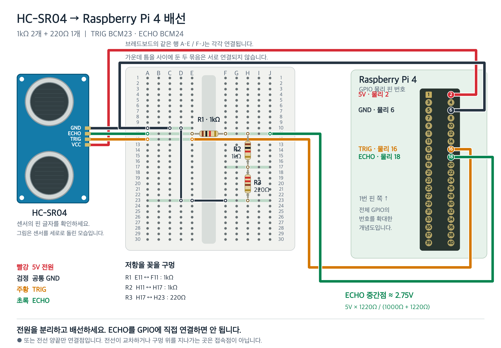

# 근접 감지 기반 사진 촬영 모듈

HC-SR04로 물체와의 거리를 측정하고, 접근 조건을 충족하면 Camera Module 3를 활성화해 사진 한 장을 로컬에 저장하는 모듈이다. 초음파 센서로 사람과 다른 물체를 구분하지는 않는다. 선택적으로 MQTT와 HTTP를 통해 Spring의 Event ID 발급과 사진 업로드를 요청하며, 설정하면 대표 사진과 이후 새 사진을 Vision 분석 서버에도 전송한다. HC-SR501과 사람 인식은 구현 범위에서 제외한다.

2026-11-17 기준, 담당자가 별도 RPi.GPIO 폴링 예제의 센서 측정과 Camera Module 3의 정상 동작을 보고했다. 이 모듈의 새 센서 구현과 통합 촬영은 실제 Pi에서 검증이 남아 있다. 같은 날 ECHO가 분압 없이 GPIO16에 직결된 상태로 확인됐으며, 보호 회로 추가와 검증도 완료되지 않았다.

## 실행 요구사항

| 구분 | 요구사항과 확인 상태 |
|---|---|
| 모의 실행·테스트 | Python 3.9 이상, 표준 라이브러리만 사용 |
| 실제 Pi | OS 제공 Python, APT 패키지, CSI 카메라와 HC-SR04 사용. 장치 출력 기준 Python 3.13.5, Debian GNU/Linux 13(trixie), `DEBIAN_VERSION_FULL=13.7`. 새 모듈의 패키지 호환성과 통합 동작은 미검증 |
| 프로젝트 목표 | SAD의 Python 3.13 목표와 실제 Pi의 3.13.5가 일치. 시스템 Python을 그대로 사용 |

장치 환경은 2026-11-16 수집한 `python3 --version`, `cat /etc/os-release` 출력으로 확인했다. 초기 단위 테스트는 `python3 -m unittest discover -s tests -v`로 실행했다. Pi의 Python 3.13.5에서 테스트 14개가 1.108초에 모두 통과했으며 개발용 Mac의 Python 3.9.6에서도 같은 14개가 통과했다. 검증 범위는 모의 센서·카메라와 오류 처리다. 실제 배선, 거리 측정, 카메라 촬영은 별도의 실물 시험 대상이다.

`test_failure_does_not_retry_held`는 촬영 실패를 의도적으로 발생시키므로 `ERROR:root: ... result=failed reason=failed` 로그가 출력된다. 해당 테스트의 `ok`와 전체 결과 `OK`가 통과 기준이다.

`pyproject.toml`의 `requires-python = ">=3.9"`는 pip 설치 시 검사하는 Python 버전 조건이다. `python3 -m` 실행에는 이 검사가 적용되지 않아 `python3 --version`으로 실행 환경을 확인한다. 패키지의 pip 설치는 필수가 아니며 시스템 Python을 그대로 사용한다.

공통 카메라·GPIO 의존성은 `requirements-apt.txt`, 원본 RPi.GPIO의 선택 설치 목록은 `requirements-apt-rpi-gpio.txt`에서 관리한다. 두 목록은 OS 패키지용이며 pip requirements에는 포함하지 않는다. OS별 패키지 가용성과 libcamera 연동 여부는 실제 Pi에서 확인할 항목이다.

## 모의 실행 및 검증

모의 실행은 `smart-doorbell/iot` 디렉터리에서 Python 3.9 이상과 표준 라이브러리만으로 수행한다. 실행 로그에는 `MOCK`가 표시되며, `captures/MOCK_*.png`에는 실제 촬영 사진 대신 프로그램이 생성한 모의 이미지가 저장된다.

```bash
cd smart-doorbell/iot
python3 -m unittest discover -s tests -v
python3 -m proximity_camera run --mode mock --max-captures 1
python3 -m proximity_camera sensor --mode mock
python3 -m proximity_camera camera --mode mock
```

기본 모의 입력은 접근, 근접 상태 유지, 측정 오류, 이탈, 재접근으로 구성되며 입력이 끝나면 프로그램이 종료된다. 실제 시간 조건까지 포함한 재감지 시험에서는 거리 해제 조건과 쿨다운 조건이 모두 충족되도록 모의 입력의 시간 조건을 설정한다. 개인 설정은 `cp config.example.json config.local.json`으로 생성하고 `--config`로 지정한다. 파일 경로의 기준은 실행 디렉터리다.

```bash
python3 -m proximity_camera run --mode mock --config config.local.json --max-captures 1
```

`--max-captures`는 촬영 시도 횟수의 상한이며 성공 횟수와는 다르다. 생략 시 모의 입력이 끝나거나 Ctrl+C가 입력될 때까지 실행한다. 설정 파일에 없는 항목에는 기본값을 적용한다. 촬영 해상도는 `camera_width`, `camera_height`로, 초점·촬영·전체 작업의 제한 시간은 각각 `camera_af_timeout_s`, `camera_capture_timeout_s`, `camera_timeout_s`로 조정한다. `config.local.json`에는 비밀번호를 저장하지 않는다.

## Raspberry Pi 구성 및 실행: 2026-11-17 기준

1. **카메라 연결.** Camera Module 3와 Pi 4의 `CAMERA` CSI 커넥터는 표준 15핀 케이블로 연결한다. 연결 작업은 전원이 꺼진 상태에서 수행하며, 케이블 양끝의 방향과 접점 배치는 [공식 연결 그림](https://www.raspberrypi.com/documentation/accessories/camera.html)을 기준으로 한다.
2. **저장소 및 실행 환경 설치.** SSH 접속 예시는 `ssh ee333@doorbell.local`이다. 연결 실패 시 장치 IP와 SSH 서비스 상태를 점검한다. 다음은 Git 설치부터 저장소 복제, 의존성 설치, 카메라 단독 촬영까지의 명령이다. `~/smart-doorbell`이 없는 신규 설치 기준이며, 별도 복사본인 `~/iot`가 있는 경우 실행 경로를 구분한다.

```bash
# Pi에서
sudo apt update
sudo apt install git
cd ~
git clone --branch jeongwon/iot-proximity-camera --single-branch https://github.com/yunho04/smart-doorbell.git
cd ~/smart-doorbell/iot
xargs -r -a requirements-apt.txt sudo apt install --
# RPi.GPIO가 이미 동작하면 해당 제공자를 유지한다. 없을 때만 아래 패키지를 설치한다.
python3 -c "import RPi.GPIO" || xargs -r -a requirements-apt-rpi-gpio.txt sudo apt install --
python3 -m venv --system-site-packages .venv
source .venv/bin/activate
cat /etc/os-release
python3 --version
hostname -I
rpicam-hello --list-cameras
rpicam-still -n --autofocus-on-capture -o test.jpg
```

설치 명령은 Raspberry Pi OS 기준 예시이며, 패키지 오류 발생 시 실제 OS의 저장소와 지원 여부를 확인해야 한다. 카메라 단독 시험의 확인 항목은 저장된 사진의 초점과 방향이다. 현재 장치의 Python은 3.13.5이며, 새 모듈의 카메라·GPIO 패키지 호환성 검증은 남아 있다.

앱의 하드웨어 촬영은 매 촬영마다 자동초점을 시작하고 `AfState` 메타데이터가 `Focused`가 될 때만 사진을 저장한다. `Scanning`을 관찰하지 못해도 `Focused`면 진행하며, 실패·시간 초과·메타데이터 누락 시 촬영을 중단한다. 로그에서 상태 변화, 렌즈 위치, 경과 시간과 오류 단계를 확인한다. 프레임 길이는 33,333~100,000µs(약 10~30fps)로 제한하므로 최대 노출이 100ms여서 어두운 환경에서 사진이 어두워질 수 있다.

자동초점 오류를 재확인할 때는 카메라 단독 명령으로 충분히 밝은 곳에서 무늬가 있는 피사체를 카메라 앞 약 30~50cm에 두고 시험한다. 초음파 센서 거리와 카메라 피사체 거리가 같다고 가정하지 않는다. 문제가 계속되면 위 `rpicam-still` 단독 결과와 앱의 autofocus 상태 로그를 함께 확인한다. 이 변경의 실제 Pi 촬영 결과는 아직 검증되지 않았다.

`python3-rpi.gpio`는 [Debian trixie 패키지](https://packages.debian.org/trixie/python3-rpi.gpio)로 제공된다. 이미 `RPi.GPIO`가 동작하는 환경에서는 기존 설치를 유지한다. 원본 RPi.GPIO와 `rpi-lgpio` 호환 래퍼는 같은 모듈 이름을 사용하므로 동시에 설치하지 않는다([설치 문서](https://rpi-lgpio.readthedocs.io/en/latest/install.html)). 기존 패키지는 임의로 제거하지 않는다.

3. **센서 배선.** 아래 회로는 실물 검증 전의 설계 예시다. 배선 작업은 센서와 저항의 표기·값을 확인한 뒤 전원이 꺼진 상태에서 수행한다. BCM 번호와 물리 핀 번호는 구분해 표기했다. 일반 HC-SR04의 ECHO는 5V이므로 GPIO 입력에는 분압 또는 레벨 변환이 필요하다([GPIO Zero 공식 배선](https://gpiozero.readthedocs.io/en/stable/api_input.html#distancesensor-hc-sr04)).

센서 핀은 단독 시험에서 동작이 보고된 TRIG BCM20(물리 38), ECHO BCM16(물리 36)을 채택했다. 참고한 강의 예제의 LED 저항은 ECHO 분압 회로와 별개다. 현재 장치에서는 ECHO 직결이 확인됐으며 보호 회로는 아직 추가되지 않았다. 하드웨어 시험은 `sudo poweroff`와 전원 케이블 분리 후 보호 회로를 추가하고, 배선·전압 확인을 마친 뒤 재개하는 조건이다.

```text
HC-SR04 VCC  ─────────────────── Pi 5V (물리 2)
HC-SR04 GND  ─────────────────── Pi GND (물리 6)
HC-SR04 TRIG ─────────────────── Pi BCM20 (물리 38)
HC-SR04 ECHO ── 1kΩ ──┬───────── Pi BCM16 (물리 36)
                      └── 1kΩ ── 220Ω ── 공통 GND
```

설계상 명목 입력 5V에서 분압 출력은 약 2.75V이며, 실제 저항값·연결·출력 전압은 확인이 필요하다. 다음 그림은 이전 BCM23/24 배선의 설계 이력으로, 현재 기본 핀과 다르다.

<details>
<summary>이전 BCM23/24 배선 예시와 그림</summary>

이전 배선에서는 보유 부품에 맞춰 1kΩ 2개와 220Ω 1개의 직렬 조합을 검토했다. ECHO에서 GND까지 저항 세 개를 연결하고 첫 번째 1kΩ 뒤의 중간점을 Pi BCM24(물리18)에 연결하는 구조다. 중간점에서 GND까지의 저항은 1kΩ+220Ω=1.22kΩ이며 명목 입력 5V에서 `5 × 1220 / (1000 + 1220) ≈ 2.75V`로 계산된다. 두 1kΩ 저항은 병렬로 연결하지 않는다.

```text
ECHO ── 1kΩ ──┬── Pi BCM24 (물리 18)
              │
             1kΩ
              │
             220Ω
              │
             GND
```



| 부품·점퍼 | 그림의 연결 좌표 |
|---|---|
| R1 1kΩ | E11 ↔ F11 |
| R2 1kΩ | H11 ↔ H17 |
| R3 220Ω | H17 ↔ H23 |
| 센서 GND / Pi GND(물리 6) | 각각 A10 / C10 |
| 공통 GND 점퍼 | D10 ↔ D23, E23 ↔ F23 두 개 |
| 센서 ECHO | A11 |
| 분압 출력 → Pi BCM24(물리 18) | J11에서 Pi로 연결 |
| 센서 TRIG / Pi BCM23(물리 16) | 각각 A12 / E12 |
| 센서 VCC | Pi 5V(물리 2)에 직접 연결 |

그림의 센서는 세로 방향이며 핀 연결은 실물의 표기를 기준으로 한다. GPIO 부분은 물리 핀 번호를 확대한 개념도다. 실제 보드에서는 1번 핀 위치를 기준으로 번호를 식별한다. 브레드보드의 같은 행 A–E와 F–J는 각각 연결되고 가운데 틈 양쪽은 분리돼 있다. 전선 양끝과 표시한 점이 접속점이며, 교차하거나 구멍 위를 통과하는 부분은 접속점이 아니다. 이전 그림과 출력·GND 행이 달라 좌표를 혼용할 수 없다. 이 비교는 과거 BCM23/24 배선에 한하며 현재 기본 BCM20/16과 구분한다.

```text
HC-SR04 VCC  ─────────────────── Pi 5V (물리 2)
HC-SR04 GND  ─────────────────── Pi GND (물리 6)
HC-SR04 TRIG ─────────────────── Pi BCM23 (물리 16)
HC-SR04 ECHO ── 330Ω ──┬──────── Pi BCM24 (물리 18)
                       └── 470Ω ─ Pi GND (예: 물리 9)
```

110Ω과 220Ω만 있는 경우의 대안은 110Ω 1개와 220Ω 3개를 직렬로 연결하는 구성이다. ECHO 쪽 합계는 330Ω, GND 쪽 합계는 440Ω이며 명목 입력 5V에서 중간점 전압은 약 2.86V다. 분압식 `Vout = Vin × R하단 / (R상단 + R하단)`에 따른 계산값으로, 실제 배선 검증 결과는 아니다. GPIO의 연결 위치는 다음 회로의 중간점이다.

```text
HC-SR04 ECHO
     │
    110Ω
     │
    220Ω
     │
     ├──────── Pi BCM24 (물리 18)
     │
    220Ω
     │
    220Ω
     │
    GND ────── Pi GND (예: 물리 6 또는 9)
```

이 대안의 VCC도 5V이며 센서와 Pi는 GND를 공유한다. 저항 조합의 변경은 GPIO 설정과 코드에 영향을 주지 않는다. 110Ω과 220Ω을 각각 한 개씩 사용해 3.33V를 만드는 구성은 입력 전압과 저항 오차에 대한 여유가 부족해 설계안에서 제외했다. 부품 수량이 부족한 경우에는 직결 대신 저항 조합을 다시 선정해야 한다.

다음은 해당 저항 조합의 브레드보드 배선 예시다. 센서는 세로 방향으로 표시했으며 연결 기준은 실물의 VCC/TRIG/ECHO/GND 표기다. 오른쪽 GPIO 그림은 물리 핀 번호 확대도이며 실제 Pi에서는 1번 핀 위치를 기준으로 해석한다. 브레드보드의 각 행 A–E와 F–J는 별도 연결이고, 전선 양끝과 표시된 점만 접속점이다.


| 부품·점퍼 | 그림의 연결 좌표 |
|---|---|
| R1 110Ω | E11 ↔ F11 |
| R2 220Ω | J11 ↔ J17 |
| R3 220Ω | H17 ↔ H23 |
| R4 220Ω | H23 ↔ H29 |
| 센서 GND / Pi GND(물리 6) | 각각 A10 / C10 |
| 공통 GND 점퍼 | D10 ↔ D29, E29 ↔ F29 두 개 |
| 센서 ECHO | A11 |
| 분압 출력 → Pi BCM24(물리 18) | F17에서 Pi로 연결 |
| 센서 TRIG / Pi BCM23(물리 16) | 각각 A12 / E12 |
| 센서 VCC | Pi 5V(물리 2)에 직접 연결 |

</details>

4. **단독 및 통합 시험.** 보호 회로 추가와 배선·전압 확인을 마친 뒤 Pi를 켜고 SSH로 접속한다. 시험 순서는 모의 실행, 카메라 단독, 센서 단독, 통합 실행이다. 기존 `config.local.json`의 BCM23/24와 `interval_s` 값은 새 기본값보다 우선한다. 개인 설정을 유지하는 경우 필요한 항목만 `trigger_bcm: 20`, `echo_bcm: 16` 등으로 수정하며, 기본값으로 실행하는 경우 `--config`를 생략한다.

```bash
cd ~/smart-doorbell/iot
source .venv/bin/activate
python3 -m proximity_camera run --mode mock --max-captures 1
python3 -m proximity_camera camera --mode hardware
python3 -m proximity_camera sensor --mode hardware
python3 -m proximity_camera run --mode hardware --max-captures 1
```

실물 시험 후에는 OS, Python, 주요 패키지 버전을 팀 검증 기록에 남긴다. 다음 명령의 실행 위치는 `iot` 디렉터리이며 출력 파일 `environment.local.txt`는 Git에서 제외된다. 이 파일은 시험 당시 환경의 스냅샷으로, 설치 의존성을 고정하는 lock 파일과는 용도가 다르다.

```bash
{
  cat /etc/os-release
  python3 --version
  xargs -r -a requirements-apt.txt dpkg-query -W -f='${binary:Package}=${Version}\n'
} > environment.local.txt
```

저장소가 이미 있는 환경에서는 `~/smart-doorbell`의 로컬 변경사항을 확인한 뒤 작업 브랜치로 전환한다. 기존 저장소를 덮어쓰는 재복제는 수행하지 않는다.

```bash
cd ~/smart-doorbell
git status
git remote set-branches --add origin jeongwon/iot-proximity-camera
git fetch origin
git switch jeongwon/iot-proximity-camera
```

이전 `codex/iot-proximity-camera`를 `--single-branch`로 복제한 환경은 fetch 대상이 해당 브랜치로 제한돼 있을 수 있다. `git remote set-branches --add`는 새 브랜치를 fetch 대상에 추가하는 명령이다. 로컬 브랜치가 없으면 `git switch`가 일치하는 원격 추적 브랜치를 기준으로 생성한다. 원격이 여러 개라 자동 선택되지 않는 경우의 명령은 `git switch --track origin/jeongwon/iot-proximity-camera`다. 브랜치 전환 시 로컬 수정은 보존하며 `reset --hard`로 덮어쓰지 않는다.

노트북에서 수정·검증 후 푸시한 코드는 Pi에서 다음 명령으로 갱신한다. 개인 설정과 촬영 이미지는 Git 관리 대상에서 제외했다.

```bash
cd ~/smart-doorbell
git pull --ff-only
cd iot
source .venv/bin/activate
```

기본 센서 백엔드는 `rpi_gpio`다. 측정 전 대기는 `sensor_settle_s=0.2`, TRIG HIGH 유지는 `trigger_pulse_s=0.01`, 반복 대기는 `interval_s=0.5`, 상승·하강의 개별 제한 시간은 `echo_timeout_s=0.1`초로 설정했다. 이 값은 단독 시험에서 동작이 보고된 강의 예제에 맞춘 설정이며 HC-SR04의 보편적인 규격을 뜻하지 않는다. 최소 트리거 간격은 0.06초, 거리 계산에 적용한 음속은 34300cm/s다.

기존 콜백 방식은 `sensor_backend`를 `lgpio`로 설정해 선택하며 백엔드 간 자동 전환은 하지 않는다. 기존 콜백에서 발생한 타임아웃의 원인은 아직 확정되지 않았다. 폴링 방식에도 OS 스케줄링에 따른 펄스 누락과 거리 오차 가능성이 있다.

통합 시험은 카메라와 센서의 단독 동작을 확인한 뒤 수행한다. 기본 촬영 조건은 50cm 이하의 거리값이 연속 3회 측정되는 경우다. 촬영 시도 후에는 70cm 이상 연속 3회와 5초 쿨다운을 모두 충족해야 다시 감지 가능한 상태로 전환된다. 중간값과 오류는 연속 횟수를 초기화하며 오류만으로 재감지를 허용하지 않는다. 촬영에 실패해도 접근 상태가 유지되는 동안에는 재시도하지 않는다.

로컬 모드의 촬영은 동기 방식이므로 촬영 중 거리 측정은 일시 중지된다. Spring 모드는 촬영 중에도 센서를 읽는다. GPIO, 거리 임계값, 시간 설정은 설치 위치와 측정 대상에 따른 조정 항목이다. 프로그램 종료는 Ctrl+C로 처리한다.

사진의 기본 저장 경로는 `captures/`다. 보관 한도는 파일 100개, 전체 100MiB, 촬영 파일당 10MiB이며 최소 여유 공간은 100MiB다. 한도에 도달하면 새 촬영을 거절하고 기존 파일은 유지한다. 실패한 임시 파일은 작업자 종료 후 삭제하며, 저장 공간 확보를 위한 기존 사진 정리는 사진 확인 후 수동으로 수행한다. `request_id`는 로컬 촬영 시도의 식별자로 서버 Event ID와는 별개다.

`echo rise timeout`과 `echo fall timeout`은 각각 제한 시간 내 상승·하강을 관찰하지 못한 상태다. 기존 lgpio의 `echo timeout`은 유효한 펄스를 얻지 못한 경우, `echo already high`는 ECHO 상태 이상, `autofocus failed`는 초점 실패를 나타낸다. 오류 점검 항목은 배선, 전원, 센서·카메라 단독 실행 결과다. SIGTERM 종료 시에도 자원 정리를 시도하지만 강제 종료나 전원 차단으로 남은 임시 파일은 수동 확인이 필요하다.

작업 공유 브랜치는 `jeongwon/iot-proximity-camera`이며 새 작업 브랜치에도 `jeongwon/` 접두사를 적용한다. 이전 `codex/iot-proximity-camera`의 코드와 커밋 이력을 이어받았고 기존 브랜치는 이력 보존용으로 유지한다. 개발 절차는 노트북에서의 구현·모의 검증, 작업 브랜치 푸시, Pi 실물 검증 순서다. `main` 병합은 팀원 상호 검증을 마친 뒤 수행한다.


## Spring 연동: MVP v1

기준 문서는 `smart-doorbell_mvp-v1_spring-api-spec.pdf`, 「AIoT 스마트 도어벨 MVP v1 Spring 연동 API 명세서」 v1.0, 2026-11-16이다. 이 절의 코드는 명세를 따르는 클라이언트 구현이며 실제 브로커·Spring 서버와의 통합 검증은 아직 완료되지 않았다.

MQTT 3.1.1에서 `doorbell/{deviceId}/event`를 QoS 1로 구독한 뒤 `doorbell/{deviceId}/sensor`에 `deviceId`, `sensorType`, `value`, `presenceDetected`를 QoS 1, retain 비활성으로 전송한다. 기본 `MOTION`은 명세의 감지 구분값이며 HC-SR04가 사람을 분류한다는 뜻은 아니다. `CREATED`와 유효한 `eventId`를 수신하면 사진 한 장을 촬영하고 `POST /api/v1/events/{eventId}/image`의 `file` 필드에 JPEG 또는 PNG로 전송한다. 성공은 201 응답의 `mediaId`, `eventId`, `mediaType`, `filePath`를 검증한다. 전송 성공 여부와 관계없이 촬영 사진은 로컬에 보관한다.

설정 예시의 `192.0.2.x`는 문서용 자리표시자다. 실제 주소를 개인 설정에 입력해야 한다. 이 클라이언트는 DNS 지연을 피하기 위해 MQTT 호스트와 HTTP(S) URL에 숫자 IP만 허용한다. 이는 PDF의 요구사항이 아니라 클라이언트의 제약이다. HTTPS는 기본 인증서 검증을 사용하며 해당 IP에 유효한 인증서가 필요하다. 예시의 HTTP와 MQTT 1883 평문은 격리된 개발망의 시연용이다.

```bash
cd ~/smart-doorbell/iot
source .venv/bin/activate
pip install -e '.[spring]'
cp -n config.spring.example.json config.local.json
# config.local.json의 mqtt_host와 spring_base_url을 실제 숫자 IP로 수정
python3 -m proximity_camera run --mode mock --spring --config config.local.json --max-captures 1
# 실물 배선·보호 회로와 단독 시험을 마친 뒤
python3 -m proximity_camera run --mode hardware --spring --config config.local.json --max-captures 1
```

`--spring`을 생략하면 기존 로컬 모드이며 추가 pip 패키지나 네트워크가 필요 없다. `--mode mock --spring`은 모의 센서와 모의 PNG를 사용하지만 MQTT와 HTTP는 **실제 서버**에 요청한다. 기존 개인 설정이 있다면 덮어쓰지 말고 필요한 Spring 항목을 추가한다. `connection_timeout_s`, `event_timeout_s`, `http_timeout_s`는 양의 유한 초 단위이며 최대 120초다. HTTP 제한은 소켓 I/O 작업별 제한으로 전체 요청의 총 경과 시간 상한은 아니다. 자동 HTTP 재시도와 MQTT 재연결·재발행은 하지 않는다.

PDF의 이벤트 응답에는 요청 식별자가 없어 사진과 Event ID의 완전한 상관관계를 보장할 수 없다. 같은 deviceId에는 생산자 하나만 운용해야 한다. 이 구현은 한 번에 하나의 이벤트를 처리하고, 시간 초과·연결 단절·불확실한 발행·서로 다른 미확인 Event ID 등 모호한 상태가 발생하면 해당 실행에서 이후 요청을 차단한다. 재시작만으로 늦은 응답이나 서버 중복 생성 문제가 해결된다는 보장은 없다. 완전한 상관관계와 QoS 1 중복 방지를 위해서는 서버와 `request_id` 반환 및 중복 처리 규격을 합의해야 한다. 업로드 결과가 불확실해도 사진은 유지되며 운영자가 서버 상태를 확인해야 한다.

## 현장 체크리스트: Pi A (2026-11-18)

`config.school.json`은 오늘 전달받은 Spring `10.21.33.82:8080`, MQTT `10.21.33.82:1883`, 장치 1과 Pi A의 클라이언트 ID `doorbell-sensor-camera-1`을 사용한다. 주소는 네트워크가 바뀌면 다시 확인한다. Pi B의 ID `doorbell-audio-speaker-1`과 달라야 한다. 기존 `config.local.json`은 덮어쓰지 않는다. ECHO 직결 이력이 있으므로 전원을 끄고 분압 또는 레벨 변환을 설치한 뒤 실물 시험한다.

7. Pi A와 서버가 같은 격리된 LAN에 있는지 확인하고, 카메라와 센서를 각각 단독 시험한 뒤 다음을 실행한다. 시작 로그에서 브로커 주소·클라이언트 ID·`doorbell/1/event` QoS 1 구독 완료를 확인한다.

   ```bash
   cd ~/smart-doorbell/iot
   source .venv/bin/activate
   pip install -e '.[spring]'
   python3 -m proximity_camera camera --mode hardware --config config.school.json
   python3 -m proximity_camera sensor --mode hardware --config config.school.json
   python3 -m proximity_camera run --mode hardware --spring --config config.school.json
   ```

9. Pi B 구독도 준비한 후 센서 앞에 접근해 `doorbell/1/sensor`의 `presenceDetected: true`와 Spring의 새 이벤트 생성 여부를 확인한다. 기존에 진행 중인 `DETECTED` 이벤트가 있으면 서버가 새 ID를 발행하지 않으므로 시험 시작 전 서버 담당자와 상태를 확인한다. 자동 삭제하지 않는다. 수동 발행은 앱이 중지된 경우에만 사용한다. 앱 구동 중 외부 발행은 예상하지 못한 이벤트 ID를 만들어 앱이 안전을 위해 중지될 수 있다.
10. 양쪽 Pi의 `eventId`와 DB의 event_id가 같은지 확인한다. Pi A는 한 방문에서 대표 사진 한 장을 Spring에 업로드하고 Vision에는 추가 사진을 전송한다. `--max-captures 1`은 작업 완료 후 종료하므로 머무는 동안 신호를 유지해야 하는 전체 시험에는 사용하지 않는다.
12. 감지 범위에서 벗어나면 true 발행을 중단한다. Spring은 마지막 true 이후 10초 경과를 기준으로 처리하지만 스케줄러와 AI 호출로 전환이 늦어질 수 있다. 실제 상태를 확인하며 기다린다.
15. 해당 ID의 이미지 업로드 201 응답과 서버 DB의 사진 연결을 확인한다. Vision 서버의 수신과 분석 결과, `COMPLETED` 전환은 실제 서버에서 별도로 확인해야 한다.

실행 중에는 유효한 근접 측정을 바탕으로 약 2초마다 true를 발행하며, 먼 거리나 측정 오류에서는 중단한다. 촬영·업로드 중에도 센서를 읽는다. 10초 이상 신호가 끊기면 촬영 작업이 끝난 뒤 서버의 해당 이벤트 상태를 조회한다. `DETECTED`라면 같은 방문을 유지하고, 그 외 상태라면 충분한 이탈 측정과 쿨다운 후 새 방문을 허용한다. 서버 상태 조회·발행 실패나 예상 밖 이벤트 ID는 중지하고 운영자가 서버 상태를 확인해야 한다. MQTT 응답에 요청 ID가 없어 서버와의 상태 조회·발행 사이 경쟁 및 중복 생성 방지를 완전히 보장하지 못한다.

관찰만 할 때는 앱과 다른 클라이언트 ID를 사용한다.

```bash
mosquitto_sub -h 10.21.33.82 -p 1883 -i doorbell-observer-1 -q 1 -v -t 'doorbell/1/#'
```

앱을 중지한 수동 단독 시험에서만 다음을 사용한다. 실제 이벤트가 생성되므로 서버 담당자와 시험 상태를 맞춘다.

```bash
mosquitto_pub -h 10.21.33.82 -p 1883 -q 1 -t doorbell/1/sensor -m '{"deviceId":1,"sensorType":"MOTION","value":1,"presenceDetected":true}'
```

### Vision 사진 전송

Spring 모드에서 `vision_base_url`을 설정하면 서버에서 발급한 Event ID로 촬영한 대표 사진을 Spring에 한 번 업로드하고, 성공하면 같은 파일을 `POST /vision/analyze`로 전송한다. 이후 방문 세션 동안 새 사진을 촬영하여 같은 Event ID로 전송한다. `vision_interval_s` 기본값과 현장 설정은 1초이며 양의 유한 값 최대 120초다. 첫 Vision 전송 시작 시각을 기준으로 이후 촬영 목표 시각을 잡고 처리 지연으로 놓친 회차는 건너뛰므로 요청이 겹치거나 밀리지 않는다. 최초 카메라 시작과 자동초점에는 추가 시간이 든다. multipart 필드 이름은 `image`, `event_id`다. 이벤트 ID를 임의로 만들지 않는다. `config.school.json`에는 현장 Vision 주소 `http://10.21.35.77:8000`이 설정되어 있다. 일반 설정의 기본값은 `null`로 비활성화되어 있으며, 필요한 경우 숫자 IP를 포함한 HTTP(S) origin을 명시한다. 예를 들어 개인 설정에 다음 항목을 추가한다.

```json
"vision_base_url": "http://10.21.35.77:8000",
"vision_timeout_s": 30,
"vision_interval_s": 1
```

`--spring` 없이 실행하면 현장 설정을 사용해도 로컬 촬영만 수행한다. `--mode mock --spring`은 모의 사진을 실제 설정된 서버로 전송한다. Vision 전송은 2xx와 JSON 객체 응답을 확인하고, 응답에 `event_id`가 있으면 발급받은 ID와 일치해야 한다. Spring 업로드에 실패하면 Vision을 호출하지 않는다. Vision 오류나 응답 시간 초과 시 자동 재전송 없이 중단하며 이미 Spring에 올라간 사진과 로컬 사진은 유지한다. 서버 상태를 확인한 뒤 운영자가 후속 조치를 결정한다. `vision_timeout_s`는 양의 유한 값으로 최대 120초이며 소켓 I/O별 제한이다. 전체 요청 시간의 절대 상한은 아니다. 분석 중에도 센서를 읽고 유효한 접근을 갱신한다. 유효한 근접 신호가 10초 이상 없으면 추가 전송을 일시 정지하고 서버 상태를 조회한다. DETECTED에서 근접 신호를 다시 발행해 확인받으면 재개하며, 종료 상태를 확인하면 반복을 멈춘다. 진행 중인 HTTP 요청은 완료될 수 있으며 모든 서버 상태 변화를 즉시 감지하는 방식은 아니다. 성공한 추가 사진은 삭제하고 대표 사진과 실패하거나 전송하지 못한 사진, 사용자 파일은 보존한다. 저장 한도에 도달하면 중단한다.

연속 실행은 다음과 같이 `--max-captures` 없이 실행한다. `--max-captures 1`은 첫 방문의 대표 사진과 첫 Vision 전송이 끝나면 반복을 종료한다. 모의 입력 종료와 Ctrl+C도 반복을 정리한다.

```bash
python3 -m proximity_camera run --mode hardware --spring --config config.school.json
```

실제 Pi에서 연속 촬영, 전송 처리량과 1초 주기는 아직 검증하지 않았다. 이 인터페이스는 제공된 Vision 소스의 요청 형식을 기준으로 구현했으며 실제 배포 서버의 접근과 업로드는 아직 검증하지 않았다. 인증 정보가 제공되지 않아 인증 헤더는 설정하지 않았다.
